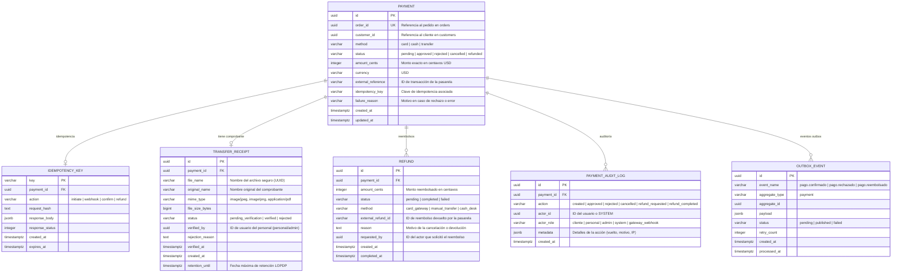
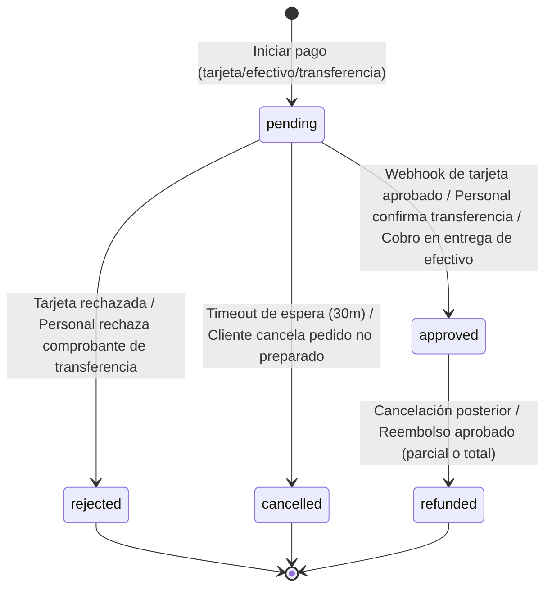

# Data Model — Spec #7: Formas de pago

**Branch**: `feature/spec-7` | **Spec**: [spec.md](spec.md) | **Date**: 2026-11-18

Este documento define el modelo de datos para el módulo `Pagos` en el esquema PostgreSQL `payments`.

---

## 1. Esquema Relacional (`payments`)

---

## 2. Máquina de Estados del Pago (`PaymentStatus`)

### Reglas de Transición:
1. `pending -> approved`:
   - En **tarjeta**: solo por webhook verificado con firma de la pasarela o consulta de estado en sandbox.
   - En **transferencia**: solo por usuario con rol `personal` o `admin` tras validar comprobante.
   - En **efectivo**: solo por usuario con rol `personal` al marcar pedido entregado en mostrador.
   - Dispara la inserción del evento `pago.confirmado` en `payments.outbox`.
2. `pending -> rejected`:
   - En **tarjeta**: pasarela reporta fondos insuficientes o rechazo.
   - En **transferencia**: personal rechaza el comprobante con motivo documentado.
   - El pedido asociado puede reintentar con otra forma de pago antes del timeout.
3. `pending -> cancelled`:
   - El plazo de pago (30 min) expiró o el cliente canceló su pedido antes de pagar.
4. `approved -> refunded`:
   - El pedido se canceló tras haber sido pagado; se genera un registro en `payments.refund`.
   - En tarjeta: se invoca el reembolso a la pasarela externa.
   - En transferencia: queda registrado como tarea manual para el personal contable.

---

## 3. Validaciones y Restricciones de Dominio

1. **Aritmética Monetaria**:
   - `amount_cents` DEBE ser un número entero positivo (`amount_cents > 0`).
   - La suma de reembolsos asociados a un pago NUNCA debe exceder el `amount_cents` original.
2. **Idempotencia Estricta**:
   - Un `order_id` solo puede tener un pago activo en estado `pending` o `approved`.
   - Cualquier intento de invocar confirmación sobre un pago ya `approved` no realiza cambios en base de datos y retorna el estado actual idempotentemente.
3. **Seguridad y Privacidad**:
   - Ninguna columna almacena números de tarjeta, CVV, ni claves bancarias del cliente.
   - Los archivos de comprobante subidos se validan por tipo MIME (`image/jpeg`, `image/png`, `application/pdf`) y tamaño máximo (5 MB).
   - `retention_until` se fija automáticamente a `NOW() + INTERVAL '90 days'`.
