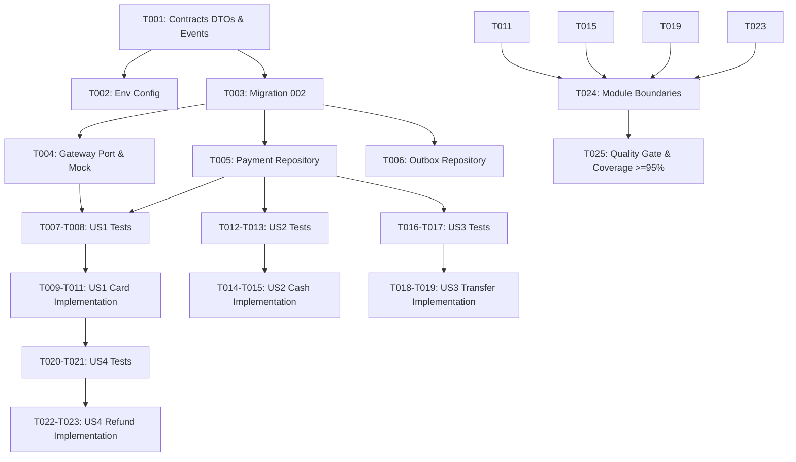

# Tasks: Formas de pago (Spec #7)

**Input**: Design documents from `/specs/007-formas-pago/` (`spec.md`, `plan.md`, `research.md`, `data-model.md`, `contracts/`, `quickstart.md`)  
**Prerequisites**: plan.md, spec.md, research.md, data-model.md, contracts/  
**Tests**: Tests are MANDATORY (Constitution VI): every user story includes unit and integration tests. TDD is strictly required for payments logic and monetary arithmetic. Cobertura >= 95 % en `apps/api/src/modules/pagos`.

---

## Phase 1: Setup (Shared Contracts & Configuration)

**Purpose**: Shared DTOs, contracts and environment configuration

- [ ] T001 Define payment DTOs, domain event interfaces, and gateway ports in `proyecto/packages/contracts/src/payments/` and re-export in `proyecto/packages/contracts/src/index.ts`
- [ ] T002 [P] Update environment configuration schema in `proyecto/packages/config/src/env.ts` with payment gateway variables (`PAYMENT_GATEWAY_PROVIDER`, `PAYMENT_GATEWAY_WEBHOOK_SECRET`, `MAX_PENDING_CASH_ORDERS`)

---

## Phase 2: Foundational (Database & Payments Core Framework)

**Purpose**: Database schema, persistence, idempotency repository, outbox and mock gateway port

- [ ] T003 Create database migration `proyecto/infra/migrations/002_payments_schema.sql` defining the `payments` schema and tables (`payment`, `idempotency_key`, `transfer_receipt`, `refund`, `audit_log`, `outbox`)
- [ ] T004 [P] Implement `PaymentGatewayPort` interface and `MockPaymentGatewayAdapter` for sandbox testing in `proyecto/apps/api/src/modules/pagos/services/gateway/`
- [ ] T005 [P] Implement `PaymentRepository` in `proyecto/apps/api/src/modules/pagos/repositories/payment.repository.ts` with atomic state transitions and idempotency key checks
- [ ] T006 Implement `OutboxRepository` in `proyecto/apps/api/src/modules/pagos/repositories/outbox.repository.ts` for atomic transactional event storage

**Checkpoint**: Core foundation ready; payments persistence and gateway mock operational.

---

## Phase 3: User Story 1 - Pagar con tarjeta (Priority: P1) 🎯 MVP

**Goal**: Cliente inicia pago con tarjeta mediante tokenización externa; la pasarela notifica la aprobación/rechazo por webhook firmado; el pedido pasa a pagado de forma idempotente sin almacenar datos de tarjeta.  
**Independent Test**: Simular pago con tarjeta de prueba en `MockPaymentGatewayAdapter`, recibir webhook firmado y verificar transición a `approved` y emisión de outbox `pago.confirmado`.

### Tests for User Story 1 (MANDATORY - Constitution VI) ⚠️
- [ ] T007 [P] [US1] Unit tests (TDD) for card session initiation, HMAC webhook signature verification, and deduplication in `proyecto/tests/unit/payments/card-payment.spec.ts`
- [ ] T008 [P] [US1] Integration test for card webhook reception and idempotency with Testcontainers in `proyecto/tests/integration/payments-card.int.spec.ts`

### Implementation for User Story 1
- [ ] T009 [US1] Implement card payment intent generation in `proyecto/apps/api/src/modules/pagos/services/payments.service.ts`
- [ ] T010 [US1] Implement webhook controller with HMAC signature validation and event deduplication in `proyecto/apps/api/src/modules/pagos/controllers/webhook.controller.ts`
- [ ] T011 [US1] Implement circuit breaker and timeout policy for external gateway calls in `proyecto/apps/api/src/modules/pagos/services/gateway/circuit-breaker.ts`

**Checkpoint**: User Story 1 completada y probada de forma independiente.

---

## Phase 4: User Story 2 - Pagar en efectivo (Priority: P1)

**Goal**: Cliente elige efectivo; el pedido entra como pendiente de cobro en mostrador; el personal registra el importe recibido, el sistema calcula el cambio, pasa el pedido a pagado y aplica el límite configurable de pedidos en efectivo pendientes por cliente.  
**Independent Test**: Crear un pedido en efectivo, registrar cobro en mostrador con importe recibido y verificar cálculo exacto de cambio y evento outbox.

### Tests for User Story 2 (MANDATORY - Constitution VI) ⚠️
- [ ] T012 [P] [US2] Unit tests (TDD) for cash payment collection, exact change calculation, and pending limit checks in `proyecto/tests/unit/payments/cash-payment.spec.ts`
- [ ] T013 [P] [US2] Integration test for cash payment workflow and limit enforcement in `proyecto/tests/integration/payments-cash.int.spec.ts`

### Implementation for User Story 2
- [ ] T014 [US2] Implement cash payment limit validation and collection service in `proyecto/apps/api/src/modules/pagos/services/cash-payment.service.ts`
- [ ] T015 [US2] Implement cash collection endpoint for staff in `proyecto/apps/api/src/modules/pagos/controllers/payments.controller.ts`

**Checkpoint**: User Story 2 completada y probada de forma independiente.

---

## Phase 5: User Story 3 - Pagar por transferencia (Priority: P2)

**Goal**: Cliente elige transferencia bancaria, visualiza datos bancarios y referencia única, adjunta comprobante; el personal verifica el comprobante y confirma o rechaza el pago con motivo; los comprobantes se gestionan bajo política de retención LOPDP.  
**Independent Test**: Subir comprobante de transferencia a un pago pendiente, verificar aprobación/rechazo por el personal y comprobar plazo de retención LOPDP.

### Tests for User Story 3 (MANDATORY - Constitution VI) ⚠️
- [ ] T016 [P] [US3] Unit tests (TDD) for transfer receipt validation, staff approval/rejection logic, and LOPDP retention date in `proyecto/tests/unit/payments/transfer-payment.spec.ts`
- [ ] T017 [P] [US3] Integration test for transfer receipt upload and verification workflow in `proyecto/tests/integration/payments-transfer.int.spec.ts`

### Implementation for User Story 3
- [ ] T018 [US3] Implement transfer receipt upload and verification service in `proyecto/apps/api/src/modules/pagos/services/transfer.service.ts`
- [ ] T019 [US3] Implement transfer endpoints (`POST /:paymentId/receipt` y `POST /:paymentId/verify-transfer`) in `proyecto/apps/api/src/modules/pagos/controllers/payments.controller.ts`

**Checkpoint**: User Story 3 completada y probada de forma independiente.

---

## Phase 6: User Story 4 - Reembolsos (Priority: P2)

**Goal**: Gestionar reembolsos idempotentes de pedidos pagados cancelados (automático vía pasarela en tarjeta; tarea manual para personal en transferencias).  
**Independent Test**: Solicitar reembolso de un pago de tarjeta aprobado y verificar comunicación con pasarela y transición a `refunded`.

### Tests for User Story 4 (MANDATORY - Constitution VI) ⚠️
- [ ] T020 [P] [US4] Unit tests (TDD) for refund processing, amount validation, and idempotency in `proyecto/tests/unit/payments/refund.spec.ts`
- [ ] T021 [P] [US4] Integration test for refund workflow and idempotency in `proyecto/tests/integration/payments-refund.int.spec.ts`

### Implementation for User Story 4
- [ ] T022 [US4] Implement refund service and gateway refund dispatch in `proyecto/apps/api/src/modules/pagos/services/refund.service.ts`
- [ ] T023 [US4] Implement refund endpoint `POST /api/payments/:paymentId/refund` in `proyecto/apps/api/src/modules/pagos/controllers/payments.controller.ts`

**Checkpoint**: User Story 4 completada y probada de forma independiente.

---

## Phase 7: Polish, Quality Gate & SonarQube Compliance

**Purpose**: Verificación de fronteras de módulos, lint, cobertura >= 95% y SonarQube Quality Gate

- [ ] T024 [P] Verify ESLint module boundaries (`boundaries/dependencies`) and public exports of `PagosModule` in `proyecto/tests/unit/payments/module-boundaries.spec.ts`
- [ ] T025 Execute complete test suite (`pnpm typecheck`, `pnpm lint`, `pnpm format:check`, `pnpm test:unit`, `pnpm test:integration`) ensuring >= 95% coverage on `apps/api/src/modules/pagos`

---

## Dependencies & Execution Order

