# Data Model: Administración, reportes y auditoría (Spec #8)

## Schema: `reports`

El módulo de reportes y administración posee su propio esquema relacional `reports`, cumpliendo con el Principio V de la Constitución (Límites de Dominio).

```mermaid
erDiagram
    ORDER_PROJECTION ||--o{ PRODUCT_SALES_DAILY : aggregates
    ORDER_PROJECTION {
        string id PK "order_id"
        string customer_id "Pseudónimo o anónimo"
        string payment_method "card, cash, transfer"
        string order_status "delivered, cancelled, refunded"
        int total_cents "Monto total del pedido en centavos"
        int discount_cents "Descuento total aplicado en centavos"
        string promotion_id "ID de la promoción aplicada (opcional)"
        string holiday_name "Nombre de la festividad (opcional)"
        timestamptz created_at "Fecha y hora del pedido"
        timestamptz delivered_at "Fecha y hora de entrega"
    }

    SALES_DAILY {
        date sale_date PK
        string payment_method PK "card, cash, transfer"
        int total_orders "Número de pedidos entregados"
        int total_cents "Suma total recaudada en centavos"
        int average_ticket_cents "Ticket medio en centavos"
    }

    PRODUCT_SALES_DAILY {
        date sale_date PK
        string product_id PK
        string product_name "Nombre del producto"
        int units_sold "Unidades vendidas"
        int total_cents "Total generado en centavos"
    }

    PROMOTION_USAGE_DAILY {
        date usage_date PK
        string promotion_id PK
        string promotion_name "Nombre de la promoción"
        string holiday_name "Festividad asociada (ej. Navidad)"
        int usage_count "Cantidad de usos"
        int total_discount_cents "Total descontado en centavos"
        int associated_sales_cents "Total vendido con la promo en centavos"
    }

    AUDIT_LOG {
        uuid id PK
        timestamptz timestamp "Fecha y hora del evento"
        string actor_id "ID del usuario o sistema que ejecuta"
        string actor_role "admin, personal, system"
        string action "PRICE_UPDATE, MENU_UPDATE, CONFIG_UPDATE, etc."
        string entity_type "product, menu, promotion, payment, user, config"
        string entity_id "ID del registro afectado"
        jsonb before_state "Estado anterior"
        jsonb after_state "Estado posterior"
        jsonb metadata "IP, user-agent o detalles"
    }

    OPERATIONAL_CONFIG {
        string config_key PK
        jsonb config_value "Valor del parámetro"
        string description "Descripción de uso"
        string updated_by "Último admin que modificó"
        timestamptz updated_at "Fecha de última modificación"
    }
```

---

## Tablas y Atributos

### 1. `reports.order_projection`
Proyección analítica de pedidos recibida vía eventos de dominio (`pedido.entregado`, `pago.confirmado`, `pago.reembolsado`).
- `id` (VARCHAR(64), PK): ID del pedido.
- `customer_id` (VARCHAR(64), NOT NULL): UUID del cliente o `'anonymous'`.
- `payment_method` (VARCHAR(32), NOT NULL): Método de pago utilizado (`card`, `cash`, `transfer`).
- `order_status` (VARCHAR(32), NOT NULL): Estado final (`delivered`, `cancelled`, `refunded`).
- `total_cents` (INTEGER, NOT NULL): Monto total en centavos.
- `discount_cents` (INTEGER, NOT NULL DEFAULT 0): Monto de descuento en centavos.
- `promotion_id` (VARCHAR(64)): ID de promoción aplicada.
- `holiday_name` (VARCHAR(128)): Festividad asociada.
- `created_at` (TIMESTAMPTZ, NOT NULL): Fecha de creación del pedido.
- `delivered_at` (TIMESTAMPTZ): Fecha de entrega efectiva.

### 2. `reports.audit_log`
Registro inmutable de trazabilidad y auditoría.
- `id` (UUID, PK, DEFAULT gen_random_uuid()): Identificador del log.
- `timestamp` (TIMESTAMPTZ, NOT NULL DEFAULT now()): Marca temporal inmutable.
- `actor_id` (VARCHAR(64), NOT NULL): Usuario o servicio que operó.
- `actor_role` (VARCHAR(32), NOT NULL): Rol del actor (`admin`, `personal`, `system`).
- `action` (VARCHAR(64), NOT NULL): Código de acción realizada.
- `entity_type` (VARCHAR(64), NOT NULL): Tipo de entidad modificada.
- `entity_id` (VARCHAR(64), NOT NULL): Clave de la entidad.
- `before_state` (JSONB): Captura del estado previo al cambio.
- `after_state` (JSONB): Captura del estado posterior.
- `metadata` (JSONB): Metadatos adicionales (IP, cliente, razón).

### 3. `reports.operational_config`
Configuración operativa en caliente gestionada por administradores.
- `config_key` (VARCHAR(64), PK): Clave del parámetro (ej. `payments.cash.max_pending_orders`, `system.maintenance_mode`).
- `config_value` (JSONB, NOT NULL): Valor tipado del parámetro.
- `description` (TEXT): Documentación del parámetro.
- `updated_by` (VARCHAR(64), NOT NULL): ID del administrador responsable.
- `updated_at` (TIMESTAMPTZ, NOT NULL DEFAULT now()): Timestamp del cambio.
